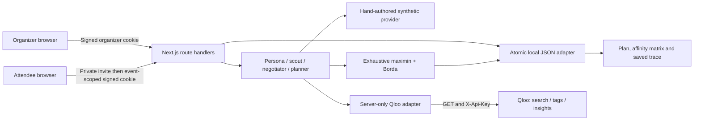

# Architecture

`src/lib/types.ts` defines the local data contract. `security.ts` signs and checks event-scoped role tokens. `store.ts` serializes local writes. `api.ts` centralizes authorization, views and validation. `request-body.ts` bounds streaming JSON bytes before buffering. `membership.ts` preserves plans on unchanged joins and invalidates scores only when membership data changes. `planner.ts` builds shared candidate evidence, deterministic persona/objection records and a selected plan. `fairness.ts` is a pure function exercised by invariant and adversarial tests. `qloo.ts` owns all vendor networking and never imports into client code. Shared `@hackathon/ui` renders saved agent steps.

The routes are POST `/api/events`, POST `/api/demo`, GET `/api/events/:id`, GET/POST `/api/join/:token`, GET `/api/search`, POST `/api/events/:id/plan` and GET `/api/events/:id/steps?after=seq`. The last route is a polling transport for historical traces. A group change during a live run fails the save instead of writing a stale matrix.

The intended hosted schema is in `drizzle/0000_quorum.sql`. Each attendee belongs to an event, each favorite to an attendee, each plan to an event, and each score to a plan/attendee/entity tuple. Traces have monotonic sequence numbers per plan. Qloo responses belong only in a private cache; never export them into public source fixtures. The hosted schema stores invite hashes; adapting link retrieval and invitation rotation is part of that migration.
